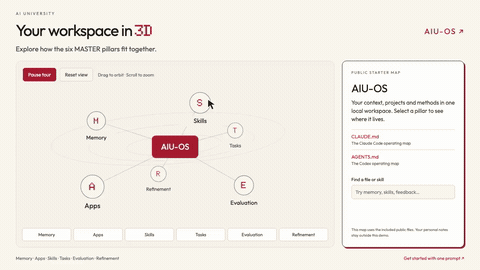

# AIU-OS: Your AI Operating System for Claude Code and Codex

[](LICENSE)

A free, **MIT-licensed starter kit** for building your own AI workspace with Claude Code or Codex. Keep your context, projects and repeatable methods in one place, using the **MASTER Framework**: Memory, Apps, Skills, Tasks, Evaluation, Refinement.

Made for anyone learning to work with AI agents: creators, business owners, teams, developers and complete beginners. You do not need to know Python or JavaScript to use the core workspace.

**AIU-OS** stands for **AI University OS**. It is the free companion to the AI University MASTER lesson. [Join the free AI University Discord](https://discord.gg/DUZwXQzfAe) for the lesson resources and community.

## Start with one prompt

Open the **[install guide](docs/GETTING-STARTED.md#copy-this-prompt)**, copy the full prompt, and give it to Claude Code or Codex with local file access. Your agent creates a new workspace and starts a short interview about your work and goals.

Your own agent application and model access are separate. No API key, package install or external account connection is required by the supplied workspace exercises.

## See how your workspace fits together

[](https://github.com/kaludisai/AIU-OS/raw/refs/heads/main/docs/media/master-map-demo.mp4)

**[Watch or download the 3D demo](https://github.com/kaludisai/AIU-OS/raw/refs/heads/main/docs/media/master-map-demo.mp4)** · **[Open the map locally](apps/master-map/README.md)**

The original AIU MASTER Map shows the six pillars around your workspace. Rotate the map, select a pillar, search its files, and open the relevant source. **Play tour** walks through the included public starter. It uses fictional practice data; it is a map of this kit, not a recording of a private workspace.

Download AIU-OS, then open `apps/master-map/index.html` in your browser. The map runs locally without a server, account, package install or external library. It does not automatically scan your computer or import personal notes.

## What you get: six ready-to-use skills

| Skill | When to use it | What it produces |
| --- | --- | --- |
| **setup-workspace** | Your first session | A short interview and a private brief about your work, goals and preferences |
| **capture-context** | Something is worth remembering | A dated note with the source and status, plus an index so it can be found again |
| **find-context** | You need a fact or previous decision | An answer grounded in your files, with conflicts and unknowns called out |
| **plan-one-task** | You have a job to get done | A saved plan or draft with the relevant inputs, constraints and next action |
| **check-work** | You want to review an output | A check against your requirements, with specific evidence and suggested fixes |
| **refine-workflow** | You have useful feedback | One focused change to the relevant context or method, followed by a retest when available |

In **Claude Code**, use `/setup-workspace`, `/capture-context`, `/find-context`, `/plan-one-task`, `/check-work` or `/refine-workflow`. In **Codex**, use the skill picker or select the matching `$skill-name`. Both host folders are included. [See examples and discovery help](docs/SKILLS.md).

## The MASTER Framework

| Pillar | The question it answers | At your agent's desk |
| --- | --- | --- |
| **Memory** | What should it know about you and the work? | The filing cabinet |
| **Apps** | Which tools can it actually use? | The computer apps |
| **Skills** | How do you want this job done? | The notebook |
| **Tasks** | What needs to happen now? | The to-do list |
| **Evaluation** | Did the result meet your requirements? | The progress report |
| **Refinement** | What should change next time? | The coaching |

The first three equip the agent. The last three put it to work, check the result and improve the next run. [Read the framework guide](docs/MASTER.md).


## How you know it is useful

- **You explain yourself less.** A new conversation finds your current brief and relevant project files instead of needing the whole backstory again.
- **You can pick up where you left off.** The output, accepted decisions and next action are saved somewhere you can open.
- **Your corrections carry forward.** Feedback changes the relevant note or method, and the next result can be checked against it.

Start with one real task. Add context, tools and methods as the work needs them. External apps begin unconnected, and nothing is scheduled by this kit.

## Your files stay with you

Your context and methods are ordinary local files. You can edit them, back them up, move them to another computer and use them with a compatible agent. AIU-OS includes `CLAUDE.md`, `AGENTS.md` and matching skill folders for Claude Code and Codex.

The useful context you build can carry forward as models change. A new agent may need a different instruction format or its own app connections. [Read the privacy and workspace guide](docs/PRIVACY.md).

## Included practice and templates

Three fictional exercises help you try the process before adding your own information:

- **Everyday planning:** a dinner plan with a budget and dietary requirements.
- **Content creation:** a short beginner explainer from supplied source notes.
- **Development:** a small feature plan with observable acceptance criteria.

[Choose an exercise](examples/README.md), or start with your own project. Templates cover a task brief, context note, run record and coaching note. Personalization goes in the Git-ignored `personal/` folder.

## Repository layout

```text
AIU-OS/
├── CLAUDE.md / AGENTS.md       Your agent's operating map
├── brief/                     Fictional practice brief
├── assets/                    Source notes and index
├── projects/                  Work and project requirements
├── examples/                  Three optional practice workflows
├── templates/                 Context, task, review and feedback records
├── connections.md             App access and test register
├── .claude/skills/             Six Claude Code methods
├── .agents/skills/             Matching Codex methods
├── apps/master-map/            Local interactive 3D starter map
├── scripts/                    Optional local search and file checks
├── tests/                      Context-search checks
├── docs/                       Setup, framework, skills and privacy
└── LICENSE                    MIT
```

`personal/` is created when you personalize the kit and stays local by default. Review files before sharing your own copy.

## Optional checks

```bash
python3 scripts/check_workspace.py
python3 tests/test_context_search.py
python3 scripts/find_context.py vegetarian
```

Python 3 is needed only for these optional utilities. The skills are editable Markdown, and the 3D map uses HTML, CSS and JavaScript. The file check verifies structure and matching maps; a real task tells you whether the work is useful.

## Links

- [One-prompt install guide](docs/GETTING-STARTED.md#copy-this-prompt)
- [Six skill examples](docs/SKILLS.md)
- [MASTER framework](docs/MASTER.md)
- [Free AI University Discord](https://discord.gg/DUZwXQzfAe)

## License

**[MIT License](LICENSE). Copyright (c) 2026 AI University.** Use, modify and share this starter under the terms in the license. Bundled fonts retain their SIL Open Font Licenses in `apps/master-map/fonts/`.
