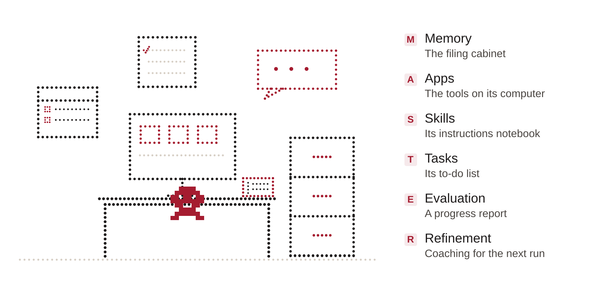
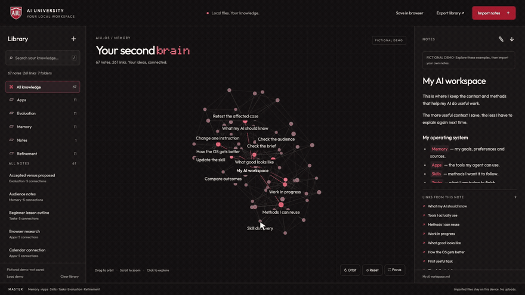

# AIU-OS: AI Operating System starter kit for Claude Code and Codex

[](LICENSE)

A free, MIT-licensed starter kit for building your own AI operating system with Claude Code or Codex. Built by **Kaludis** for **AI University**.

For anyone learning to work with AI agents: creators, business owners, teams, developers and complete beginners. Keep your context, projects and repeatable methods together using the **MASTER Framework**: Memory, Apps, Skills, Tasks, Evaluation, Refinement.

The kit starts with a short **setup-workspace** interview. Use **capture-context** to save useful information, **find-context** to retrieve it, **plan-one-task** to turn a goal into work, **check-work** to review the result, and **refine-workflow** to improve the next run. The included **Second Brain** lets you explore linked notes in 3D.

**AIU-OS** stands for **AI University OS**. The kit works for anyone; it is the free companion to the MASTER masterclass and the [AI University Discord](https://discord.gg/DUZwXQzfAe).

## The test

Open a fresh conversation in your workspace. Can your agent find the relevant context, understand the task and pick up the saved work without you explaining everything again?

That is what this kit helps you build. Start with one useful task, then add context and methods as you need them.

## How you'll know it's working

1. **You explain yourself less.** Your agent finds your current brief, preferences and relevant sources instead of asking for the whole backstory.
2. **You can pick up where you left off.** The output, accepted decisions and next action are saved in files you can open.
3. **Your corrections carry forward.** Feedback changes the relevant context or method, and you can check whether the next result improves.

These are things to observe in your own work. The kit does not promise a universal speed increase or run tasks in the background by itself.

## The MASTER Framework

| Pillar | What it does | At your agent's desk |
| --- | --- | --- |
| **Memory** | Keeps your goals, preferences, sources and decisions findable | The filing cabinet |
| **Apps** | Gives the agent tools it can actually use | The computer apps |
| **Skills** | Saves methods for repeatable jobs | The notebook |
| **Tasks** | Defines the job, inputs, output and next action | The to-do list |
| **Evaluation** | Checks the result against the goal and sources | The progress report |
| **Refinement** | Turns real feedback into a focused, tested improvement | The coaching |

The first three equip the agent. The last three put it to work, check the result and improve the next run. [Read the framework guide](docs/MASTER.md).



## What ships — six skills

| Skill | Purpose | When to use it |
| --- | --- | --- |
| **setup-workspace** | A short setup interview that saves your confirmed answers in a private brief | Your first session |
| **capture-context** | A dated, source-linked note and an index so it can be found later | A useful fact, preference or decision comes up |
| **find-context** | An answer grounded in your files, with conflicts and unknowns called out | You need previous context or a decision |
| **plan-one-task** | A saved plan or draft with inputs, constraints and a next action | You have a job to get done |
| **check-work** | A review against the brief and acceptance criteria, with specific evidence | A draft or result is ready to check |
| **refine-workflow** | One focused change to the relevant context or method, followed by a retest when available | Real feedback reveals something worth improving |

The skills work from ordinary Markdown files. Both Claude Code and Codex copies are included. [See commands and examples](docs/SKILLS.md).

## Quick start

Copy the full prompt from the **[install guide](docs/GETTING-STARTED.md#copy-this-prompt)** and give it to Claude Code or Codex with local file access. Your agent downloads the kit into a new workspace, reads the operating map and starts the setup interview.

You need your own agent application and model access. The supplied workspace exercises require no API key, package install or external account connection. You do not need to know Python or JavaScript to use them.

## See your knowledge in 3D

[](https://github.com/kaludisai/AIU-OS/raw/refs/heads/main/docs/media/second-brain-demo.mp4)

**[Watch the 20-second demo](https://github.com/kaludisai/AIU-OS/raw/refs/heads/main/docs/media/second-brain-demo.mp4)** · **[Second Brain instructions](apps/second-brain/README.md)**

Import a folder of Markdown notes and explore how your ideas connect. Every node is a note; connections come from `[[wikilinks]]` and relative Markdown links inside those notes. Search titles and content, filter by folder, click a node to read it, and follow its links and backlinks.

Create or edit notes in the viewer, download an individual Markdown file, export the library as a portable backup, or explicitly save a snapshot in this browser. Drag to orbit, scroll to zoom, and use Focus for a clean graph view.

To open it, download AIU-OS and double-click **`apps/second-brain/index.html`**. No server, account, package install or API key is required. The app makes no network requests and reads only the files you select.

The recording uses the included **67-note fictional demo**. Importing your own notes replaces that demo. Changes update the app's view without overwriting your original files; export or save to keep them. Browser snapshots stay in that browser and are not cloud backups. [Usage, limits and privacy](apps/second-brain/README.md).

A lightweight [MASTER framework map](apps/master-map/README.md) is also included for an overview of the six pillars.

## Using the kit in Codex

The six skills are included under `.agents/skills/`. Use the skill picker or select the matching `$skill-name`, such as `$setup-workspace` or `$find-context`.

Claude Code uses the matching `.claude/skills/` folder. Run `/setup-workspace`, `/capture-context`, `/find-context`, `/plan-one-task`, `/check-work` or `/refine-workflow` there. If a skill does not appear, ask your agent to read its exact `SKILL.md` file and check discovery. A file existing does not prove the host has loaded it.

## First-time setup

1. Use the [one-prompt install guide](docs/GETTING-STARTED.md#copy-this-prompt), or download the ZIP and open its root folder in your agent. Keep the hidden skill folders.
2. Run **setup-workspace**. Answer the questions you want to answer; confirmed personal context goes into the Git-ignored `personal/` folder.
3. Bring one real task. Use **plan-one-task** with the relevant brief and source files, then save the output in its project.
4. Use **check-work** to review the result. Decide what you accept and what needs changing.
5. When a correction is worth reusing, use **refine-workflow** to update the relevant method and check the affected case again.
6. As your work grows, use **capture-context** to save useful information and **find-context** to retrieve it. Open a fresh conversation to check that the saved context is actually findable.

If you want to practice first, [choose one of three fictional exercises](examples/README.md): everyday planning, content creation or development. Templates cover task briefs, context notes, run records and feedback.

## Your files stay with you

Your context and methods are local files. You can edit them, back them up, move them to another computer and use them with a compatible agent. A new agent may need its own instruction format or app connections, but the useful context you have saved can carry forward.

This public kit contains fictional examples. Personalization happens locally. Cloning the repository does not publish your local edits; review the exact files before sharing your own copy. External apps start unconnected, and nothing is scheduled by this kit. [Privacy and workspace guide](docs/PRIVACY.md).

## Repo layout

```text
AIU-OS/
├── README.md
├── CLAUDE.md / AGENTS.md       Matching operating maps
├── LICENSE                    MIT
├── brief/                     Fictional practice brief
├── assets/                    Source notes and index
├── projects/                  Work and project requirements
├── examples/                  Three optional practice workflows
├── templates/                 Context, task, review and feedback records
├── connections.md             App access and test register
├── .claude/skills/             Six Claude Code methods
├── .agents/skills/             Matching Codex methods
├── apps/second-brain/          Local notes and 3D knowledge graph
├── apps/master-map/            Optional MASTER framework overview
├── scripts/                    Optional local search and file checks
├── tests/                      Search and Second Brain model checks
└── docs/                       Setup, framework, skills and privacy
```

`personal/` is created when you personalize the kit. Keep it private when sharing your own work.

## Optional checks

```bash
python3 scripts/check_workspace.py
python3 tests/test_context_search.py
python3 scripts/find_context.py vegetarian
node tests/test_second_brain.cjs
```

Python 3 is needed only for the Python utilities; Node.js is needed only for the JavaScript model checks. Neither is required to open the Second Brain. The skills are editable Markdown, and the apps use HTML, CSS and JavaScript. Structural checks verify files and routes; a real task tells you whether the work is useful.

## License + attribution

[MIT License](LICENSE). © 2026 Kaludis.

**AIU-OS and the MASTER Framework were built by Kaludis for AI University.** You can use, modify and share the kit under the MIT License. Keep the copyright and license notice with copies. Bundled fonts retain their SIL Open Font Licenses in each app's `fonts/` folder.

The companion masterclass introduces the MASTER Framework and shows how the pieces fit together. The video link will be added here when it is published.

[Join the free AI University Discord](https://discord.gg/DUZwXQzfAe).
